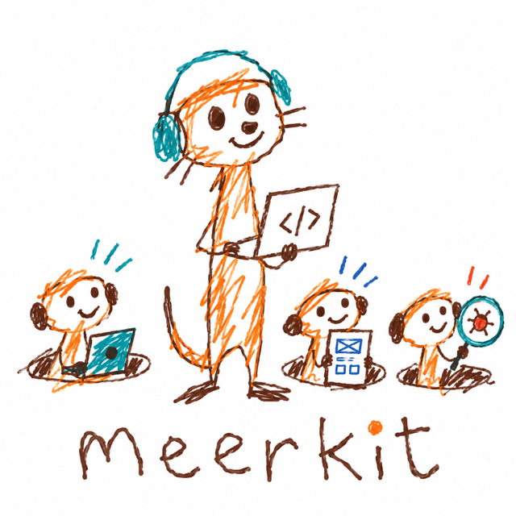

<p align="center"></p>

# meerkit

A Claude Code plugin that forms and maintains your project's team of AI roles: pm, tech lead, builders, researchers, and more later (oncall, designer, marketing). Roles coordinate through an issue tracker, not chat, so the record survives every session.

Status: early. Slice 1 works (form, add, remove, the pm and tech-lead roles, settings). The tmux launcher, hooks, update and groom are not built yet.

## How it works
- `/meerkit:form` interviews you, installs the default roles into the project and writes a short "Team sessions" section into the project `CLAUDE.md`.
- Each role file is a hash-checked **Core** (generic, never hand-edited) plus a **Project** section (your answers and rules, which win). The Core can be updated without losing your rules.
- Every limit is a named setting. A project overrides only what differs, in `.claude/meerkit/settings.json`.
- The tracker is required. Beads is supported for now (`trackers/beads.md`).
- Cards carry an appetite and a `fast` or `full` track. Your open questions live as `decision` cards, so you always see one list.

## Install
```
/plugin marketplace add oalpay/meerkit
/plugin install meerkit@meerkit
```

## Requirements
Claude Code, `uv` (Python 3.12+), `git`, `gh`, and [beads](https://github.com/gastownhall/beads) (`bd`).

## Develop
```
uv run pytest                                # unit tests
uv run tests/sim/run.py --out <dir> --dry    # seed the simulation boards, no model
uv run tests/sim/run.py --out <dir>          # behavior simulation; costs tokens
claude plugin validate .
```
Design decisions and rules are in `CLAUDE.md`.
